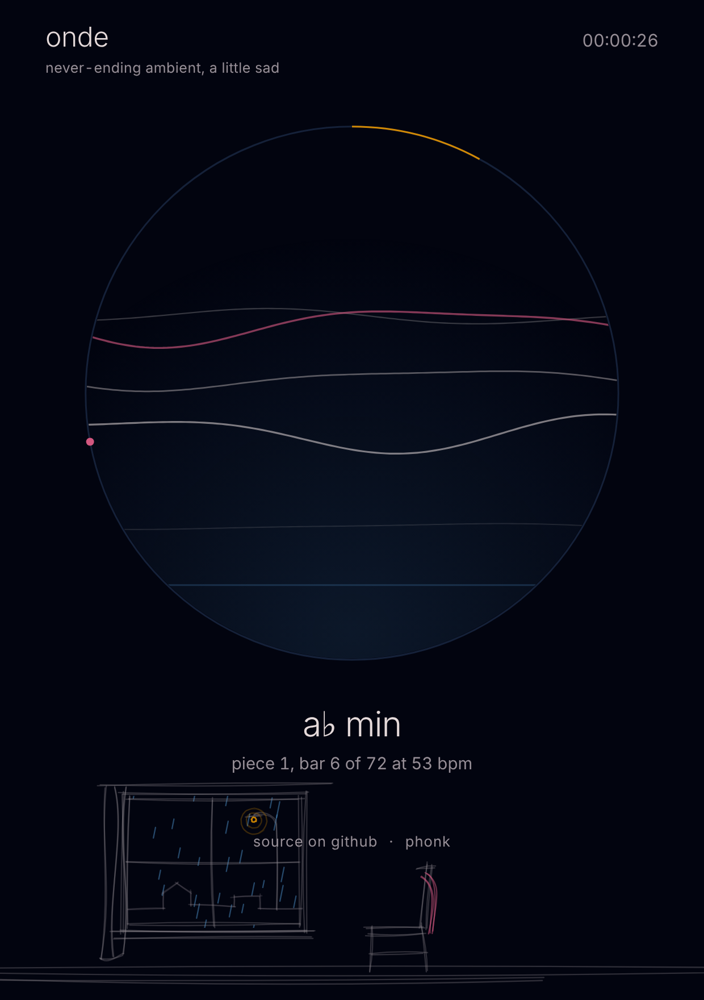

# onde

*never-ending ambient, a little sad*

Slow, dark ambient that is generated live in your browser and never plays the same way twice. Nothing is recorded: every pad, pulse and echo is synthesised as you listen. One HTML file, no samples, no dependencies, no install.

**▶ Play it: [phonk.github.io/onde](https://phonk.github.io/onde/)**

## Play

There is one thing to touch: **the circle**. Tap it to start, tap it again to stop. Every start is a new sequence of pieces.

## What you see

- **Each line in the circle** is a voice of the pad. It grows thicker and brighter as that voice swells, and fades as it leaves. The pink line is the one voice that moves from note to note.
- **The blue floor** at the bottom rises with every pulse of the sub.
- **The amber rings** are the high notes that get lost in the echo.
- **The rim** shows the piece: the amber arc is how far it has gone, the pink dot goes round once per bar.

Under the circle you read the key, the piece number, the bar and the tempo. The clock at the top is how long it has been running.

Behind it all, at the bottom of the page, there is a room sketched loosely in pen: a window with the curtain pulled aside, an empty chair turned towards it, roofs and a street lamp outside. It rains while the music plays, and the lamp glows a little more with every pulse.

## Notes

- Pieces last five to eight minutes and fade into each other, in related keys, at 52 to 62 bpm.
- It can run for as long as you leave it open.
- On a phone it keeps playing with the screen off, and you can stop it from the lock screen. If the phone cuts the audio anyway, the circle goes back to *tap*: one tap starts again.
